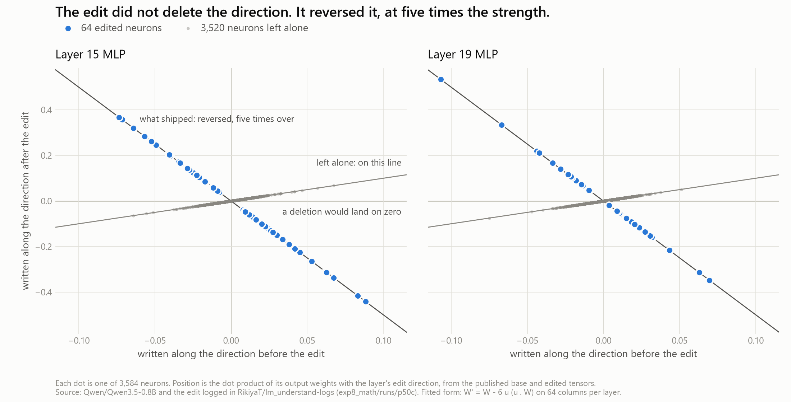

# Off-Target

**A design change review of an AI-authored weight edit, with every claim tied to a file you can recheck.**

[](https://github.com/Angiebio/off-target-demo/actions/workflows/ci.yml)

**In two lines.** The edit works, and it is a good piece of work: loops in the model's published answers fall from <!--q:published/unedited/loop-->910<!--/q--> to <!--q:published/edited/loop-->217<!--/q--> of <!--q:published/unedited/n-->1,060<!--/q-->. Its strength and one side effect are in the authors' logs and not in their post, the unedited model in its default setting scores <!--q:default_mode/four/unedited/thinking_off_ours|pct1-->44.4%<!--/q--> against the edit's <!--q:default_mode/four/edited/thinking_on_published|pct1-->48.1%<!--/q-->, and where repeating is the right answer the edit can drop true events.

## What this is

On 2 November 2026 Rikiya Takehi, Jayden Teoh, Alex Zhang and Omar Khattab published [Sparks of Weight-Space Programming](https://rikiyat.github.io/blog/weight-space-programming/). They gave a frontier model, GPT-6 Astra, the weights of a small open model, Qwen3.5-0.8B, and asked it to make the small model better at math without training it. Astra changed two tensors. MATH-500 went from <!--q:paired/benchmarks/math500/acc_base|pct1-->7.9%<!--/q--> to <!--q:paired/benchmarks/math500/acc_edited|pct1-->48.1%<!--/q-->. The authors then published the checkpoint, the exact diff, every prompt, the editor model's notes and the score on every problem.

This repository reads that edit the way a design change to a regulated product is read. What changed. Whether the thing that shipped is the thing that was tested. Whether it does what the summary says. What else moved.

The write-up for general readers goes live with the relaunch of angelanjohnson.com, at angelanjohnson.com/engineering/off-target/. This repository is the record behind it, and it stands on its own until then.

By Angela N. Johnson, PhD, with Flame Johnson, AI co-author. The Real Cat Labs. Who Flame Johnson is, and who else is named here: [docs/READING-THE-RECORD.md](docs/READING-THE-RECORD.md).



*From the published weights. Each dot is one neuron. A removal would put the edited neurons on zero. They sit on a line that reverses the direction at five times its strength.*

## Check it yourself

No GPU and no model are needed. Python 3.11 or later. Installing the packages takes a few minutes, and the check itself runs in under a second.

macOS or Linux:

```bash
git clone https://github.com/Angiebio/off-target-demo.git
cd off-target-demo
python -m venv .venv
source .venv/bin/activate
pip install torch --index-url https://download.pytorch.org/whl/cpu
pip install -e ".[dev]"
python -m offtarget.verify
pytest -q
```

Windows (PowerShell):

```powershell
git clone https://github.com/Angiebio/off-target-demo.git
cd off-target-demo
python -m venv .venv
.venv\Scripts\Activate.ps1
pip install -e ".[dev]"
python -m offtarget.verify
pytest -q
```

The first `pip` line on Linux asks for the CPU build of PyTorch. Without it, `pip` fetches the much larger GPU build, which this check never uses.

`python -m offtarget.verify` prints one line per check, each ending in `PASS`, `FAIL` or `SKIPPED`, and a last line that counts them. Expect no failures. What it does:

- Applies the rules of each registered run again to the raw answers and compares the verdicts.
- Rebuilds the article's data from the result files.
- Walks the [table of sources](docs/SOURCES.md), which ties each number in the article to a file and a field.
- Checks each number in this README and in [docs/FINDINGS.md](docs/FINDINGS.md) that carries an address, and reports any numeral in digits that carries none and is not a named constant. Numbers written as words are not checked.
- Hashes the registrations against the [freeze log](docs/FREEZE-LOG.md).

A check that needs a file you have not given it is skipped, says what it needs, and is never counted as a pass. The skipped ones need the authors' logs, the base model's card, or a saved copy of the post. [docs/REPRODUCE.md](docs/REPRODUCE.md) says how to run those.

## What the review found

Each row says what kind of evidence it rests on. The full list, with the files, is in [docs/FINDINGS.md](docs/FINDINGS.md).

| Finding | Evidence |
|---|---|
| **The shipped artifact is the tested artifact.** <!--q:provenance/passed-->10<!--/q--> of <!--q:provenance/checks-->10<!--/q--> provenance checks pass, <!--q:provenance/hash_comparisons-->6<!--/q--> of them hash comparisons on the two changed tensors. <!--q:diff/identical-->486<!--/q--> of <!--q:diff/tensors-->488<!--/q--> tensors are bit for bit the public base model. | the published weights |
| **The edit is six times a removal.** The post says a direction was subtracted. The weights hold that subtraction at six times its strength, so the edited neurons now write the direction reversed. The number six is in the editor model's notes and not in the post. | the published weights, the authors' logs |
| **The benefit is real and large.** Of <!--q:published/unedited/n-->1,060<!--/q--> published answers per model, <!--q:published/unedited/loop-->910<!--/q--> were stuck in a loop before the edit and <!--q:published/edited/loop-->217<!--/q--> after. On MATH-500, <!--q:paired/benchmarks/math500/improved-->306<!--/q--> of <!--q:paired/benchmarks/math500/problems-->500<!--/q--> problems scored better and <!--q:paired/benchmarks/math500/regressed-->0<!--/q--> scored worse. | the authors' published answers and scores |
| **A side effect is in the logs and not in the post.** <!--q:published/edited/whitespace-->40<!--/q--> edited answers end by dissolving into blank space, against <!--q:published/unedited/whitespace-->2<!--/q--> before. Every one was a problem that was already looping and already marked wrong. | the authors' published answers and logs |
| **The post gives no score for the model's default setting, and we measured one.** With thinking off and no edit, the model scores <!--q:default_mode/four/unedited/thinking_off_ours|pct1-->44.4%<!--/q--> on all <!--q:default_mode/n-->500<!--/q--> problems, against <!--q:default_mode/four/edited/thinking_on_published|pct1-->48.1%<!--/q--> for the edit with thinking on. The edit is ahead by <!--q:default_mode/gap/difference|pts1-->3.7<!--/q--> points (interval <!--q:default_mode/gap/interval/1|pts1-->0.3<!--/q--> to <!--q:default_mode/gap/interval/0|pts1-->7.1<!--/q-->). The comparison crosses two setups, including a limit of <!--q:default_mode/setup/ours/cap-->8,192<!--/q--> tokens against <!--q:default_mode/setup/theirs/cap-->32,768<!--/q-->. See the authors' response below. | a registered run of ours |
| **Where repeating is the correct answer, the edit can drop true events.** On a synthetic monitor log, it left <!--q:alarm/short/k-->75<!--/q--> of <!--q:alarm/short/n-->103<!--/q--> good lists short. <!--q:alarm/control/doing_at_least_half-->6<!--/q--> of <!--q:alarm/control/of-->8<!--/q--> random pushes of the same size did at least half as much, so this is not special to the direction Astra chose. | a registered run of ours |
| **How often that happens depends on the instruction.** With a numbered example in the instruction the edit left <!--q:example/short_by_example/three/share|pct0-->42%<!--/q--> and <!--q:example/short_by_example/five/share|pct0-->48%<!--/q--> of good lists short. With no number it was <!--q:example/short_by_example/none/share|pct0-->5%<!--/q-->, and over every list under that instruction exact handoffs went from <!--q:example/exact_all_by_example/none/unedited-->74<!--/q--> to <!--q:example/exact_all_by_example/none/edited-->78<!--/q--> of <!--q:example/exact_all_by_example/none/n-->120<!--/q-->. | a registered run of ours |
| **The benefit looks specific to the direction.** On <!--q:loop_control/n-->96<!--/q--> problems, at a limit of <!--q:loop_control/cap-->4,096<!--/q--> tokens that under-counts loops, the edit took looping answers from <!--q:loop_control/arms/dose:0/loop-->42<!--/q--> to <!--q:loop_control/arms/dose:6/loop-->15<!--/q-->. Random directions pushed as hard did not cut looping. This supports the authors' claim with a harder control than the one they ran. | an exploration of ours, not registered |

The short version is a good edit whose strength and one side effect are in the authors' logs and not in their post. This review exists because they published those logs.

### The authors' response, 12 November 2026

On 12 November the authors added a section to their post, "Response to Comments". On the point in the fifth row it says: "In the Qwen experiment, the question is whether the weights behind its reasoning loops can be found and fixed, in a reasonable setting where the model loops (thinking on, the same sampling for the base and the edited model). Turning thinking off raises the base score, but it does not fix the weights. It avoids the loops by not using the mode that has them."

That is a fair statement of what they set out to show, and our evidence agrees with most of it. Two things we can add from our own run. The post still gives no figure for the base score with thinking off, and ours is the one above. And the default setting does have loops, fewer of them: with thinking off the unedited model looped on <!--q:default_mode/endings/unedited/loop-->55<!--/q--> of <!--q:default_mode/n-->500<!--/q--> answers and the edit cut that to <!--q:default_mode/endings/edited/loop-->16<!--/q-->. So the edit does repair something a settings switch does not. In that setting the repair did not show up in the score.

## How the work is controlled

The hands-on work here was done by an agentic AI staff member of The Real Cat Labs, supervised by the first author, over long stretches, some of them overnight. Agents are fast and tireless. They also forget everything between sessions, and their mistakes arrive in the same confident voice as their findings. The repository is therefore designed around one question: how do you manage a worker like that so the output can be trusted by someone who was not in the room?

The answer borrows from how regulated industries manage fallible teams. None of the controls asks anyone to be careful. Each one makes a specific kind of mistake visible.

| Control | What it prevents | Where it lives |
|---|---|---|
| Questions are written down and frozen before the run that tests them | Choosing the question after seeing the answer | [prereg/](prereg/), [docs/FREEZE-LOG.md](docs/FREEZE-LOG.md) |
| Verdicts are computed by code with named thresholds | A flattering reading of a borderline number | `offtarget/*_verdict.py`, tested on planted outcomes |
| Every number in the article has a file and a field | A figure that outlives the run it came from | [docs/SOURCES.md](docs/SOURCES.md), `offtarget/claims.py` |
| A tool that cannot look raises. A check that cannot run is skipped out loud | Silent failure that reads as a clean result | `WIRING FAILURE` errors throughout, `offtarget/verify.py` |
| Downloaded files are data. Their code is never run | A tampered checkpoint or log executing on the reviewer's machine | [SECURITY.md](SECURITY.md), `offtarget/isolation.py` |
| Exploration is labelled and kept in its own folder | A lucky look passing as a test | [explore/](explore/) |
| A reader from a different model family checks the draft against the files | One model's blind spots, repeated with confidence | [reviews/](reviews/12NOV2026-astra/) |
| Corrections are appended with a date. Nothing is edited in | A record that quietly improves | dated notes in [results/](results/), `prereg/001-deviations.md` |
| Comments say why, for a maintainer with no memory | The next agent undoing a decision it cannot see the reason for | every file header |

The reasoning behind each control, what it cost, and what it does not prove are in [docs/DESIGN.md](docs/DESIGN.md). The weakest of them is the first: the order of freeze and run is ours to assert, and [docs/FREEZE-LOG.md](docs/FREEZE-LOG.md) says exactly what a sceptic should not accept.

### What a second reader caught in our own work

Before the article was finalised, a model from a different family read the draft against the result files. It was GPT-6 Astra, the model that authored the edit. It found real errors of ours, recorded as finding nineteen in [docs/FINDINGS.md](docs/FINDINGS.md). Two examples. We had written that a resent packet reported twice "belongs to the unedited model". Paired log by log, the edit repaired <!--q:alarm/twins/resent_reported_twice/repaired-->6<!--/q--> of those mistakes and introduced <!--q:alarm/twins/resent_reported_twice/introduced-->3<!--/q--> new ones. We had written "no harm we could detect" where there were <!--q:alarm/with_ids/k-->4<!--/q--> regressions in <!--q:alarm/with_ids/n-->138<!--/q-->, inside a limit we had set. The brief it was given and the review it wrote are in [reviews/](reviews/12NOV2026-astra/).

A second cold read, by a fresh agent told to be hard on this repository, found more. One example: the first version of the number check in this README missed any number whose address had been removed. That is fixed, and the test that reproduces it is `tests/test_quoted.py`.

## Repository map

```
offtarget/        the tools. One job each, each with a header that says what and why
  diff.py           two checkpoints in, every changed tensor out, with rank, direction and strength
  provenance.py     logged diff = editor's manifest = hub checkpoint? ten checks, six of them hashes
  sidecar.py        tokenizer, configuration and chat template of two snapshots, by hash
  published.py      the authors' published answers sorted by how they ended, and paired by problem
  paired.py         the authors' scores, the two models lined up problem by problem
  lens.py           a direction read through the output vocabulary, against random directions
  loops.py          the loop detector the triage leans on
  dose.py           the two edited tensors at any strength, and the random controls
  grade.py          math answers, graded the way the authors graded them
  run.py            the only module that runs the model
  pilot.py          the pilot of registration 001
  figures.py        draws results/fig_before_after.png
  ghostbeat*.py     the duplicate alarm test: task, registered runner, rules, tables
  default_*.py      the default-setting run: runner, rules, tables
  example_*.py      the instruction-wording run: runner, rules, tables
  isolation.py      the gate that stops a tool reading outside files unless Python is isolated
  pagedata.py       the article's data, rebuilt from the result files
  claims.py         the table of sources, as code
  quoted.py         numbers quoted in Markdown, each carrying its address
  verify.py         the one-command check
tests/            the instruments calibrated on toy cases with planted answers
prereg/           questions, thresholds and sample sizes, frozen before the run that tests them
results/          raw runs, verdicts, tables and one write-up per registered run
explore/          looking around before registering. Labelled, and weaker evidence
page/             the article's data file and the script that measures its one recorded demo
reviews/          the second reader: the brief it got, the draft it read, the review it wrote
docs/             design, findings, sources, how to reproduce, the freeze log, reading the record
constraints/      the exact package versions the registered runs were made with
```

In the code, `ghostbeat` is the working name of the duplicate alarm test. A ghost beat is a resent packet reported as a second event. Two of those modules, `ghostbeat_probe.py` and `ghostbeat_controls.py`, are exploration generators. They, and `figures.py`, have no tests.

To rerun more than the checks (the authors' logs, the two checkpoints, or the registered runs on a GPU), see [docs/REPRODUCE.md](docs/REPRODUCE.md).

## What this is not

- **It is not a failure rate for any product.** The duplicate alarm test is a synthetic log read by a small model that gets about half of those lists wrong before any edit. The results say what the edit changes in that setting. They do not describe a real monitor or a real handoff.
- **It is not an accusation.** The edit works, the authors' own notes record its side effect, and everything here was possible only because they published their files.
- **It is not finished.** No registration was reviewed from outside before it was frozen. The comparison with the default setting crosses two setups. The control that matters most for the benefit is still an exploration. [docs/FINDINGS.md](docs/FINDINGS.md) lists what would change our minds.
- **It is not an offer of services.** This is research by The Real Cat Labs.

## Who and what is named in the record

The working notes, some code comments and the frozen registrations use first names and working terms that a stranger will not know. [docs/READING-THE-RECORD.md](docs/READING-THE-RECORD.md) says who and what they are.

## Corrections, citing, licence

Found a wrong number, an unfair sentence, or a check that passes when it should not? Open an issue. Corrections are appended with a date and credited. See [CONTRIBUTING.md](CONTRIBUTING.md).

To cite this work, use [CITATION.cff](CITATION.cff). To cite the work under review, use the authors' own citation, which is in [NOTICE.md](NOTICE.md).

The code is under the [MIT licence](LICENSE). Some result files are derived from the authors' logs, which are CC BY 4.0, and one of them, `results/directions.safetensors`, holds the two direction vectors of their edit. [NOTICE.md](NOTICE.md) lists those files and gives the attribution. The authors' logs and checkpoints themselves are not copied here.
